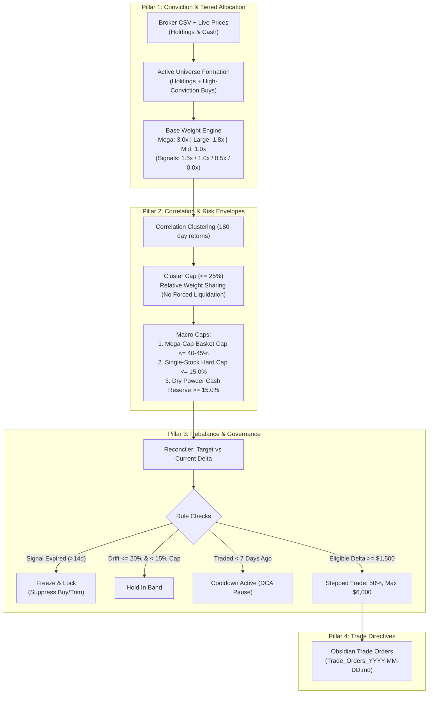
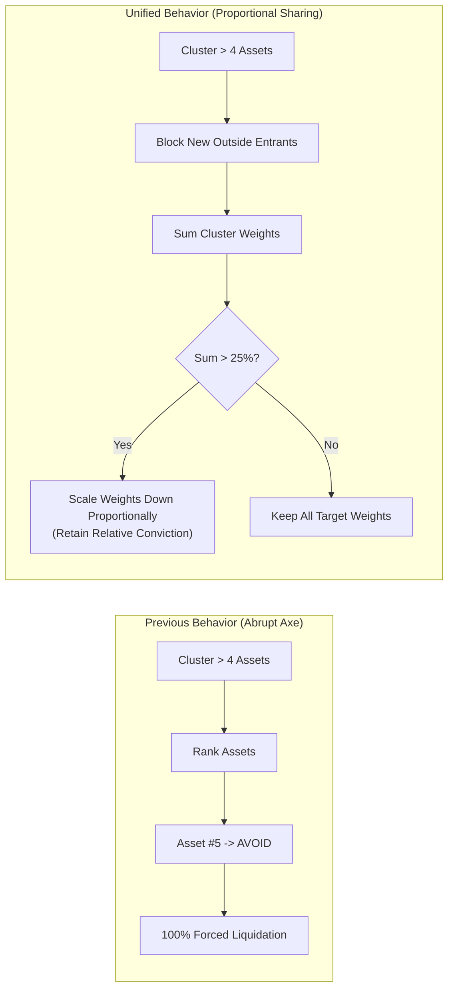
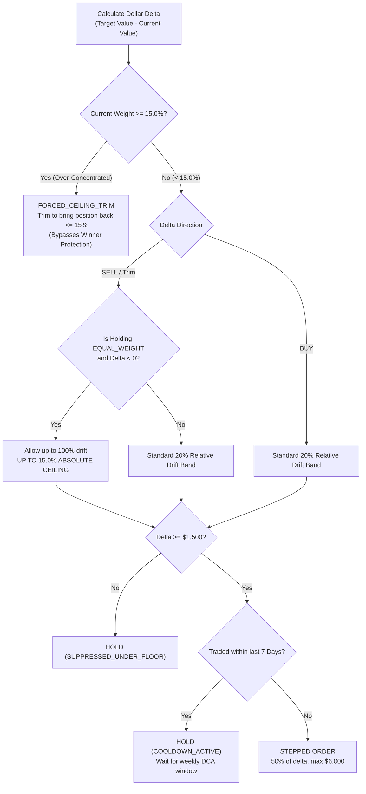
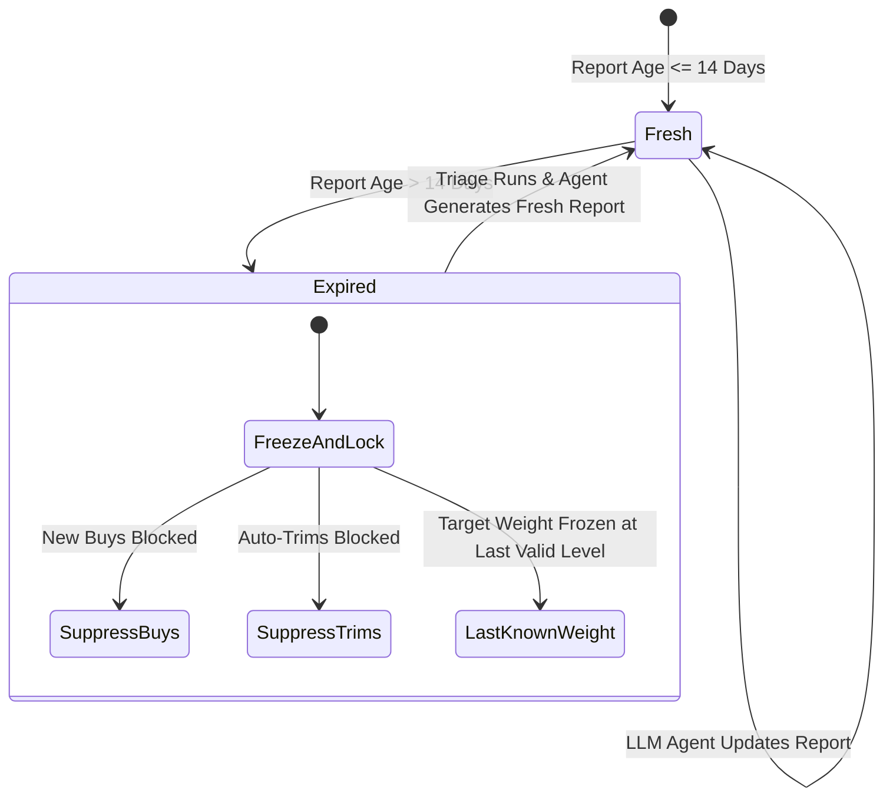

# Unified Portfolio Management Strategy & Architecture

---

## 1. Executive Overview

This unified architecture establishes a **Four-Pillar Deterministic Control Framework** designed specifically for a **value-investing, dollar-cost-averaging (DCA)** methodology.

---

## 2. The Four Pillars of the Unified System

### Pillar 1: Conviction & Capital Allocation

1. **Market-Cap Maturity Anchoring:**
   * **Mega-Cap Core ($\ge \$200\text{B}$):** Base multiplier `3.0x` (Anchor stability: META, GOOG, MSFT, AMZN, NVDA, AAPL).
   * **Large-Cap Compounders ($\$50\text{B} - \$200\text{B}$):** Base multiplier `1.8x` (High-conviction core: SPGI, MCO, BKNG, UBER).
   * **Mid/Emerging Satellite ($< \$50\text{B}$):** Base multiplier `1.0x` (High-upside satellites: HIG, EG, WDC, ALAB).
2. **Analyst Signal Modulator:**
   * `OVERWEIGHT`: `1.5x` | `EQUAL_WEIGHT`: `1.0x` | `UNDERWEIGHT`: `0.5x` | `AVOID`: `0.0x`.
   $$\text{Raw Target Weight}_i = \text{TierMultiplier}_i \times \text{SignalMultiplier}_i$$
3. **Aggregate Mega-Cap Basket Cap ($\le 40\% - 45\%$):**
   * *The Guardrail:* To prevent Big Tech from dominating the portfolio, the sum of all holdings in the $\ge \$200\text{B}$ tier is strictly capped at **40% (or 45%)**.
   * If the sum of mega-cap weights exceeds 45%, they are scaled down proportionally, ensuring that **at least 40%–45% of equity capital is guaranteed for high-conviction large- and mid-caps**.

---

### Pillar 2: Correlation Cohesion (Soft Cap & Weight Sharing)

No holding is ever liquidated solely because a statistical cluster expanded.

#### The Cluster Weight-Sharing Rules:
1. **Entry Gate:** If a correlation cluster already contains $\ge 4$ assets, no *new* candidate ticker from the watchlist may be initiated into this cluster.
2. **Existing Holdings Protection:** If market-wide correlation spikes cause existing holdings to group together into a cluster with $N \ge 5$ assets, **all $N$ holdings are retained**.
3. **Proportional Cluster Ceiling:** The combined target weight of all members in any single cluster cannot exceed **25.0%**.
   * If $\sum_{i \in \text{Cluster}} W_i > 25.0\%$, every member's target weight is scaled down proportionally by factor $S = \frac{0.25}{\sum W_i}$.
   * Relative conviction differences between stocks in the cluster are fully preserved.

---

### Pillar 3: Disciplined Execution & The 15% Unbreakable Ceiling

#### Core Risk Envelopes:
1. **Unbreakable Single-Stock Hard Cap ($\le 15.0\%$):**
   * Even if `hold_drift_tolerance` allows a winner to float, the position's current value is **hard-capped at 15.0% of the live portfolio**.
   * If a position reaches 15.1%, it immediately triggers a stepped trim regardless of analyst rating.
2. **Value DCA Stepping & Cooldown:**
   * Tranches remain at **50% of delta, capped at $6,000 per order**.
   * A **7-calendar-day cooldown** guarantees weekly accumulation or divestment, eliminating whipsaws.
3. **Dry Powder Floor:**
   * **15.0% cash reserve** is maintained at all times. Total buys cannot draw cash below this floor.

---

### Pillar 4: Signal Lifecycle & Research Governance ("Freeze & Lock")

1. **Held Positions with Stale Reports ($> 14$ days):**
   * Target weight is **frozen at its last-known valid level**.
   * The position is placed in a **`HOLD_LOCKED_PENDING_RESEARCH`** state.
   * No buy orders and no discretionary rebalance trims will be generated until an analyst agent evaluates the company.
2. **Non-Portfolio Candidates with Stale Reports:**
   * Excluded from entering the portfolio until refreshed.
3. **Automated Triage Visibility:**
   * Stale reports appear at the very top of `Trade_Orders_YYYY-MM-DD.md` in the triage queue, prompting you or the automated background runner to refresh them with `python main.py --run-agents --stale`.
